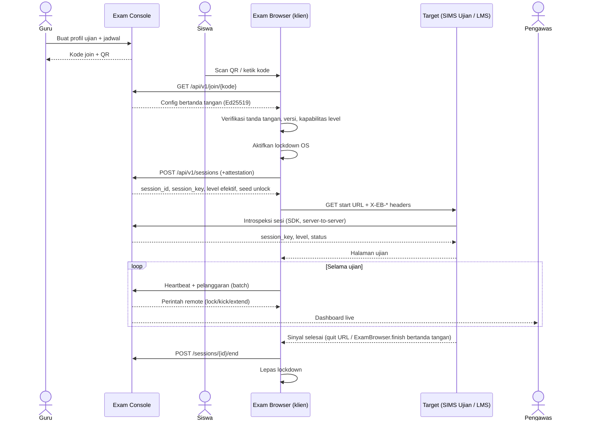
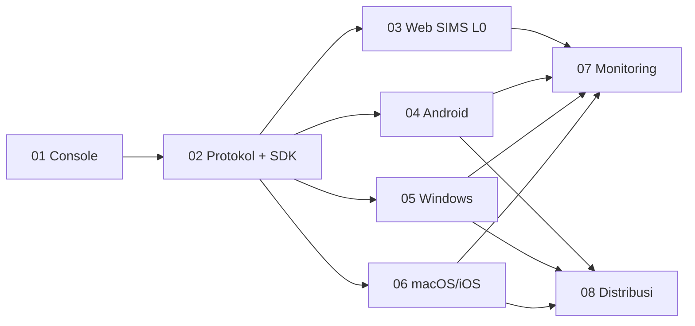

# PRD - B'tive Exam Browser

## 1. Document status

- Status: **Approved (draft Gate 1 disetujui FL, 2026-11-16)**
- Owner: FL
- Last updated: 2026-11-17 (sinkron dengan SPEC v1 approved)
- Source discovery: sesi Claude Code 2026-11-16 (jawaban FL: semua platform + mode web SIMS, produk umum + integrasi SIMS, klien native per platform, konfigurasi dikelola admin panel server)
- Artefak existing yang dirujuk:
  - `app/Support/ModeUjian.php` — mode ujian web SIMS (lockdown level aplikasi)
  - `app/Survei/SafeExamBrowser.php` + `docs/survei-safe-exam-browser.md` — integrasi SEB berbasis Browser Exam Key
  - `apps/sims-kios-macos/` — prototipe kios macOS (AppKit + WKWebView + Automatic Assessment Configuration + device key)
  - `resources/views/components/arena-focus-lock.blade.php` + `docs/android-arena-focus-bridge.md` — mode fokus web + bridge Android

## 2. Problem and context

Sekolah klien B'tive menjalankan ujian berbasis komputer (CBT) lewat modul Ujian SIMS dan kadang lewat LMS/form pihak ketiga. Saat ini ada tiga pendekatan yang terpisah dan tidak konsisten:

1. **Mode Ujian web** — hanya menutup modul lain di SIMS; siswa tetap bisa pindah tab/aplikasi, split-screen, screenshot, atau membuka chatbot AI.
2. **Safe Exam Browser (SEB)** — kuat di Windows/macOS/iOS, tetapi **tidak ada klien Android resmi** (mayoritas perangkat siswa), setup profil rumit (SEB Config Tool, salin BEK manual per versi), dan tidak ada dashboard pengawas terpadu.
3. **Prototipe SIMS Kios macOS** — hanya macOS dan hanya survei.

Akibatnya: guru tidak punya satu cara standar untuk "mengunci" ujian di semua perangkat, pengawas tidak bisa melihat pelanggaran secara live, dan BEK SEB harus diperbarui manual setiap update profil/versi.

**Kenapa sekarang:** penggunaan AI generatif oleh siswa saat ujian meningkat tajam; sekolah meminta jaminan integritas ujian sebagai syarat memakai CBT SIMS penuh.

## 3. Users and stakeholders

| Role | Goal | Pain point | Permission boundary |
|---|---|---|---|
| Siswa (peserta) | Mengerjakan ujian tanpa gangguan, jawaban tidak hilang | Aplikasi crash/terkunci, bingung cara masuk | Hanya bisa join sesi dengan kode valid; tidak bisa keluar sebelum selesai/di-unlock |
| Pengawas | Memantau kelas live, membantu siswa yang bermasalah | Tidak tahu siapa yang pindah aplikasi; tidak bisa membuka kunci tanpa password global | Hanya sesi yang ditugaskan; melihat kode unlock tercatat di log |
| Guru / pembuat ujian | Membuat profil ujian sekali, dipakai semua platform | Setup SEB rumit | CRUD profil ujian milik lembaganya |
| Admin lembaga | Mengatur integrasi, level minimum, user, perangkat terkelola | Tidak ada kontrol terpusat | Semua data dalam `lembaga_id`-nya saja |
| Integrator LMS pihak ketiga | Memverifikasi bahwa request datang dari Exam Browser | Tidak ada API verifikasi | API key integrasi per lembaga; hanya introspeksi sesi milik lembaganya |
| Super admin B'tive | Mengelola lembaga, rilis aplikasi, kunci tanda tangan | — | Lintas tenant, semua aksi tercatat |

## 4. Goals, non-goals, and success metrics

### Goals

- G1. Satu **Exam Console** untuk membuat profil ujian yang berlaku di Android, Windows, macOS, iOS/iPadOS, dan mode web SIMS.
- G2. Klien native per platform yang mengunci perangkat sedalam yang diizinkan OS, dengan **Integrity Level** (L0–L3) yang terukur dan dapat diverifikasi server.
- G3. Protokol terbuka + SDK sehingga **LMS/CBT pihak ketiga** dapat memverifikasi request; integrasi **first-class ke modul Ujian SIMS**.
- G4. Pengawas punya **dashboard live** (pelanggaran, status, kode unlock per siswa, remote command).
- G5. Setup satu kelas < 10 menit: guru buat profil → siswa scan QR/ketik kode → mulai.

### Non-goals

- Proctoring AI berbasis webcam/wajah/mikrofon (kandidat fase lanjut).
- Membuat bank soal, penilaian, atau CBT sendiri — konten ujian tetap milik SIMS Ujian / LMS target.
- Mencegah kecurangan lewat **perangkat kedua**, kamera eksternal, capture HDMI, atau joki fisik. Batas ini dinyatakan eksplisit ke sekolah.
- Kompatibilitas penuh format file `.seb` (import profil SEB = Later).
- Klien Linux / ChromeOS (Later).

### Success metrics

| Metric | Target | Cara ukur |
|---|---|---|
| Deteksi/blokir bypass | ≥ 95% skenario red-team checklist per platform | Checklist `features/08` TASK-007, dijalankan per rilis |
| Sesi bebas crash | ≥ 99,5% | Crash reporting per platform |
| Kehilangan jawaban karena klien | 0 kasus | Klien tidak boleh keluar sebelum target mengonfirmasi submit / pengawas unlock |
| Waktu ambil + verifikasi config | p95 < 2 detik (4G) | Telemetri `join` |
| Waktu setup satu kelas | < 10 menit | Pilot sekolah, observasi |
| Adopsi | ≥ 80% ujian CBT SIMS di sekolah pilot memakai level ≥ L1 dalam 1 semester | Data console |

## 5. Scope and assumptions

### MVP

- Exam Console (Laravel 12, multi-tenant `lembaga_id`): profil ujian, kode join/QR, config ter-tanda-tangan, integrasi API.
- Protokol integritas v1 + SDK PHP (Laravel middleware) dan Node.
- Integrasi modul Ujian SIMS ("Wajib Exam Browser" + level minimum per jadwal).
- Mode Browser SIMS (L0).
- Klien Android, Windows, macOS, iOS/iPadOS (L1; L2 bila attestation tersedia).
- Dashboard pengawas live, kode unlock per siswa, remote lock/kick.
- Pipeline rilis bertanda tangan + enforcement versi minimum.

### Later

- L3 penuh: Android Device Owner provisioning, profil MDM Apple (Autonomous Single App Mode), Windows Assigned Access — dokumentasi di MVP, otomasi Later.
- Import file `.seb`.
- Proctoring kamera/AI, rekaman layar terenkripsi.
- Klien Linux/ChromeOS.
- Model lisensi/billing untuk lembaga non-B'tive.

### Assumptions / open questions

- A1. **Console adalah aplikasi Laravel terpisah** dari SIMS (multi-tenant `lembaga_id`), SIMS menjadi integrasi pertama. Alasan: produk dipakai juga oleh LMS pihak ketiga. *Bila FL memilih menanam console di dalam SIMS, fitur 01/02 berubah tenant key menjadi `school_id` dan TASK scaffold dihapus.*
- A2. Repo baru (monorepo) `btive-exam-browser/` (sudah di-scaffold 2026-11-17 di `/Users/macbookpro/Downloads/Proyek/btive-exam-browser`) dengan struktur di §9; SIMS hanya menerima perubahan di fitur 02 (TASK-007) dan 03.
- A3. Server punya HTTPS publik; perangkat siswa online saat join dan saat submit. Koneksi boleh putus sementara di tengah ujian (telemetri di-queue).
- A4. Sekolah menyediakan akun Apple Developer (Organization), Google Play Console, dan sertifikat code signing Windows (OV/EV) atas nama B'tive.
- OQ1. Model bisnis/lisensi untuk lembaga non-B'tive — belum diputuskan (tidak memblokir MVP).
- OQ2. Apakah Apple menyetujui entitlement `com.apple.developer.automatic-assessment-configuration` untuk bundle produk umum (bukan hanya SIMS)? Diajukan di fitur 06 TASK-006.
- OQ3. Kebijakan retensi data telemetri/pelanggaran (usul: 1 tahun ajaran, lalu anonimisasi) — perlu konfirmasi sekolah.

## 6. Requirements

### Functional

- REQ-001: Guru dapat membuat **profil ujian** berisi: nama, start URL, aturan URL allow/block bertipe host/prefix/glob (regex ditunda ke protokol v2 — SPEC §6), level integritas minimum, platform yang diizinkan, jadwal buka/tutup, kebijakan keluar (quit URL / sinyal selesai / kode pengawas), opsi (izinkan kalkulator, zoom, spell-check).
- REQ-002: Console menerbitkan **kode join 6 karakter + QR** per sesi ujian dengan masa berlaku dan rate limit.
- REQ-003: Config yang dikirim ke klien **ditandatangani Ed25519** (kanonisasi JCS/RFC 8785, `kid` untuk rotasi); klien menolak config yang tidak valid, kedaluwarsa, atau versi klien di bawah minimum.
- REQ-004: Klien melakukan **handshake sesi** dan (L2) menyertakan attestation platform; server mengembalikan `session_id` + `session_key` dan integrity level efektif.
- REQ-005: Setiap navigasi dan request yang ditandatangani membawa header `X-EB-Session`, `X-EB-Ts`, `X-EB-Request-Hash` = HMAC-SHA256(`session_key`, `"BTEB-REQ-v1\n"` + `ts` + `\n` + URL kanonis) sesuai SPEC §11; halaman dapat meminta tanda tangan untuk XHR/fetch lewat JS API `ExamBrowser.sign(url)`.
- REQ-006: SDK (PHP/Laravel, Node) memverifikasi header di sisi target memakai introspeksi sesi server-to-server dan menolak request dengan level < minimum atau skew waktu > 120 detik.
- REQ-007: Klien native menerapkan lockdown per platform (fitur 04/05/06) dan mencatat **pelanggaran** (kehilangan fokus, overlay, perekaman layar, VM/RDP, root/jailbreak, multi-monitor, proses terlarang).
- REQ-008: Telemetri (heartbeat, pelanggaran, lifecycle) dikirim batch, **idempoten per `event_uuid`**, dan di-queue lokal saat offline.
- REQ-009: Klien **tidak keluar** sebelum (a) target mengirim sinyal selesai bertanda tangan / quit URL, (b) pengawas memasukkan kode unlock, atau (c) quit password darurat dipakai. Crash → relaunch melanjutkan sesi yang sama.
- REQ-010: Pengawas melihat **dashboard live** per sesi: status tiap peserta, level, versi app, pelanggaran, heartbeat terakhir.
- REQ-011: Pengawas dapat melihat **kode unlock TOTP per peserta** (berlaku 1 sesi, 60 detik), dan mengirim perintah remote: lock, kick, unlock, tambah waktu. Setiap tampilan kode dan perintah tercatat di activity log.
- REQ-012: Modul Ujian SIMS dapat mewajibkan Exam Browser + level minimum per jadwal/paket, dan meneruskan pelanggaran mode web (L0) ke console.
- REQ-013: Mode Browser SIMS (L0) memaksa fullscreen, mendeteksi pindah tab/aplikasi, memblokir copy/paste/klik kanan, dan mengunci halaman setelah ambang pelanggaran.
- REQ-014: Admin lembaga mengelola **integrasi** (API key di-hash, scope, IP allowlist opsional) dan **perangkat terkelola** (registrasi device key untuk L2/L3).
- REQ-015: Super admin mengelola **rilis aplikasi** per platform dan versi minimum yang dipaksakan.
- REQ-016: Rekap pelanggaran per sesi dapat diekspor (xlsx) oleh guru/admin yang berwenang.

### Non-functional

- NFR-001: Semua primary key **UUID** (`HasUuids`); data tenant memakai **`lembaga_id` + global scope** — tidak ada filter tenant manual per query.
- NFR-002: Otorisasi lewat **Spatie permission + Policy**; aksi sensitif (lihat kode unlock, remote command, ubah profil, ekspor pelanggaran, kelola integrasi/kunci) tercatat di **spatie/activitylog**.
- NFR-003: Write multi-tabel memakai `DB::transaction()`.
- NFR-004: UI console dan klien default **Bahasa Indonesia** (i18n siap untuk English).
- NFR-005: Kunci privat penandatangan config disimpan di luar DB (env/secret manager), mendukung rotasi tanpa downtime (`kid`). `session_key` dan seed TOTP disimpan terenkripsi (Laravel encrypted cast).
- NFR-006: API publik (`join`, `sessions`, `telemetry`) rate-limited; join code brute-force dibatasi per IP dan per kode.
- NFR-007: Dashboard live memperbarui status ≤ 5 detik untuk 1.000 peserta serentak per lembaga; ingest telemetri ≥ 500 event/detik per instance.
- NFR-008: Klien start-to-ready (config terverifikasi, halaman pertama tampil) ≤ 5 detik di perangkat kelas menengah.
- NFR-009: Klien lulus **test vectors protokol** bersama (`protocol/test-vectors/`) di CI — satu sumber kebenaran untuk kanonisasi, tanda tangan, HMAC, TOTP.
- NFR-010: Windows: semua perubahan sistem (registry policy, desktop) **dijamin dipulihkan** saat keluar normal, crash, atau start berikutnya.
- NFR-011: Data siswa minimal: klien hanya mengirim device info teknis (model, OS, versi app) — tidak mengirim daftar aplikasi lengkap, kontak, atau lokasi.

## 7. Core flows

**Flow alternatif:**

- FLOW-02 Unlock darurat: siswa bermasalah → pengawas buka detail peserta → lihat kode TOTP (tercatat) → siswa masukkan kode di klien → klien keluar, event `unlocked_by_proctor`.
- FLOW-03 Crash/resume: klien crash → relaunch otomatis/manual → klien menemukan sesi aktif di storage aman → re-handshake dengan `session_id` lama → lanjut di URL terakhir.
- FLOW-04 Mode web SIMS (L0): siswa buka SIMS di browser biasa → jadwal mewajibkan L0 → gate fullscreen → pelanggaran dilaporkan SIMS → diteruskan ke console.
- FLOW-05 Level kurang: jadwal mewajibkan L1 tetapi siswa membuka di browser biasa → SIMS menampilkan halaman "Buka dengan Exam Browser" + deep link `btive-eb://join/{kode}` + tautan unduh.

## 8. UX and design scope

**Console (web, Blade/Livewire, design system mengikuti SIMS):**

- SCR-C01 Daftar profil ujian · SCR-C02 Form profil (tab: Umum, Akses URL, Keamanan, Keluar, Lanjutan) dengan preview JSON config
- SCR-C03 Detail sesi + kode join/QR besar (mode proyektor)
- SCR-C04 Dashboard pengawas live (grid peserta berwarna: hijau aktif, kuning peringatan, merah pelanggaran berat, abu offline)
- SCR-C05 Detail peserta (timeline event, perangkat, tombol kode unlock & perintah)
- SCR-C06 Integrasi (API key ditampilkan sekali) · SCR-C07 Perangkat terkelola · SCR-C08 Rilis aplikasi (super admin)

**Klien native (layout seragam semua platform):**

- SCR-K01 Beranda: input kode + tombol scan QR + status perangkat (level yang bisa dicapai)
- SCR-K02 Pra-ujian: ringkasan profil, checklist perangkat (baterai, jaringan, monitor tunggal), tombol "Mulai & kunci perangkat"
- SCR-K03 Layar ujian: WebView fullscreen + bar tipis (nama ujian, jam, indikator koneksi, tombol bantuan/kalkulator bila diizinkan)
- SCR-K04 Overlay pelanggaran / terkunci pengawas · SCR-K05 Input kode unlock · SCR-K06 Selesai (jawaban terkirim, perangkat dibuka)

**State wajib:** loading, offline (banner + queue), config tidak valid, versi usang (tombol update), level tidak terpenuhi (alasan spesifik), sesi ditutup, dikunci pengawas.

**Aksesibilitas:** ukuran teks mengikuti setting OS di dalam WebView; target sentuh ≥ 44pt; kontras WCAG AA; screen reader OS tidak diblokir bila profil mengizinkan (siswa berkebutuhan khusus — accessibility service whitelist per profil).

## 9. Technical decisions

| Area | Keputusan | Alasan |
|---|---|---|
| Console | Laravel 12 + Blade/Livewire/Alpine, MySQL 8, Redis, Laravel Reverb (websocket) | Konsisten dengan stack FL; Reverb untuk dashboard live |
| Tenancy | `lembaga_id` + global scope trait `BelongsToLembaga` | Produk umum lintas sekolah/lembaga |
| Kriptografi | Ed25519 (libsodium) untuk config; HMAC-SHA256 untuk request; TOTP RFC 6238 (SHA-256, 6 digit, 60 detik) untuk unlock; JCS RFC 8785 untuk kanonisasi | Tersedia native di semua platform; deterministik |
| Android | Kotlin, Jetpack Compose (shell), Android WebView, Room + WorkManager (queue telemetri), minSdk 26, targetSdk 36 | Lock Task API, `FLAG_SECURE`, Play Integrity |
| Windows | .NET 8 (WPF) + WebView2 (Evergreen; fixed-version untuk lab offline-update) | Desktop terpisah, keyboard hook, `SetWindowDisplayAffinity` |
| macOS / iOS / iPadOS | Swift, satu Swift Package `ExamBrowserCore` + target AppKit dan UIKit/SwiftUI, WKWebView, `AEAssessmentSession` | Automatic Assessment Configuration = lockdown resmi Apple |
| Web L0 | Komponen Blade + JS di SIMS, reuse `arena-focus-lock` dan `ModeUjian` | Sudah ada, tinggal diperluas |
| SDK | `btive/exam-browser-laravel` (Composer), `@btive/exam-browser` (npm) | Integrasi LMS pihak ketiga |
| Repo | Monorepo `btive-exam-browser/`: `console/`, `clients/android/`, `clients/windows/`, `clients/apple/`, `sdk/php/`, `sdk/node/`, `protocol/` (SPEC.md + test-vectors) | Test vectors dipakai bersama di CI semua klien |

**Integrity Level:**

| Level | Syarat | Contoh |
|---|---|---|
| L0 | Browser biasa + komponen web lock SIMS | Chrome di laptop siswa |
| L1 | Klien native, config terverifikasi, lockdown OS aktif, header HMAC valid | App Android tanpa Play Integrity lolos |
| L2 | L1 + attestation lolos (Play Integrity `MEETS_DEVICE_INTEGRITY`, App Attest, atau device key terdaftar/TPM di Windows) + tidak terdeteksi root/VM/RDP | App resmi di HP siswa normal |
| L3 | L2 + perangkat terkelola (Android Device Owner, MDM Apple Single App Mode, Windows Assigned Access) | Tablet/lab milik sekolah |

Level efektif dihitung **server** dari bukti handshake, bukan klaim klien. Klien dapat turun level di tengah sesi (mis. root terdeteksi) → event + status di dashboard; target menolak request bila di bawah minimum.

**Keterbatasan yang didokumentasikan:** iOS/Android tidak dapat mencegah kamera perangkat lain; Windows tidak dapat memblokir Ctrl+Alt+Del (SAS) — dimitigasi dengan desktop terpisah + policy `DisableTaskMgr`/`DisableLockWorkstation` + deteksi pergantian desktop; Android tanpa Device Owner menampilkan konfirmasi screen pinning ke siswa.

## 10. Data and API scope

### Entities (console)

| ID | Entity | Kolom kunci |
|---|---|---|
| ENT-01 | `lembaga` | uuid, nama, slug, status |
| ENT-02 | `users` | uuid, lembaga_id, nama, email, password; role via Spatie |
| ENT-03 | `exam_profiles` | uuid, lembaga_id, nama, start_url, url_rules (json), min_level, platforms (json), quit_policy (json), options (json), version, created_by |
| ENT-04 | `exam_sessions` | uuid, lembaga_id, exam_profile_id, profile_snapshot (json, immutable), join_code, opens_at, closes_at, status, config_signature, kid |
| ENT-05 | `client_sessions` | uuid, lembaga_id, exam_session_id, device_id (nullable), peserta_ref, platform, app_version, app_build, device_info, lockdown_mode, handshake_level, effective_level, level_reasons, session_key (encrypted), unlock_seed (encrypted), status, last_seq, last_heartbeat_at, last_heartbeat, started_at, expires_at, ended_at, end_reason |
| ENT-06 | `devices` | uuid, lembaga_id (**wajib** — hanya perangkat terdaftar lembaga; perangkat pribadi tidak disimpan, info teknisnya ada di `client_sessions.device_info`), nama, platform, public_key, public_key_sha256 (unik), managed (bool), model, os_version, registered_by, registered_at, revoked_at, last_seen_at |
| ENT-07 | `client_events` | uuid (= event_uuid dari klien, primary key → idempoten), lembaga_id, client_session_id, seq, type, severity, payload (json), occurred_at (ms), received_at — append-only |
| ENT-08 | `remote_commands` | uuid, lembaga_id, client_session_id, type, payload, issued_by, delivered_at, acked_at |
| ENT-09 | `integrations` | uuid, lembaga_id, nama, key_prefix, key_hash, scopes (json), ip_allowlist (json), last_used_at |
| ENT-10 | `signing_keys` | kid, public_key, status (active/retiring/revoked), activated_at — kunci privat tidak di DB |
| ENT-11 | `app_releases` | uuid, platform, version, build, min_supported (bool), download_url, checksum, released_at |

Relasi antar tabel ber-tenant (client_sessions → exam_sessions/devices, client_events/remote_commands → client_sessions) memakai FK komposit `(…_id, lembaga_id)`.

`peserta_ref` = identitas peserta dari target (mis. UUID siswa SIMS atau username LMS) yang dikirim target lewat parameter bertanda tangan atau diisi siswa; console tidak menyimpan data pribadi siswa selain nama tampilan opsional.

### API (v1)

| ID | Endpoint | Auth | Keterangan |
|---|---|---|---|
| API-01 | `GET /api/v1/join/{code}` | publik, rate-limited | Config bertanda tangan + `kid` |
| API-02 | `GET /api/v1/keys` | publik | Daftar public key aktif (JWKS-like) |
| API-03a | `POST /api/v1/sessions/challenge` | publik, rate-limited | Challenge sekali pakai (300 detik) untuk nonce attestation — SPEC §8.1 |
| API-03 | `POST /api/v1/sessions` | config valid + challenge | Handshake; body: attestation, device info, `peserta_ref`; return session_id, session_key, level, unlock_seed |
| API-04 | `POST /api/v1/sessions/{id}/resume` | HMAC sesi | Lanjutkan setelah crash |
| API-05 | `POST /api/v1/sessions/{id}/events` | HMAC sesi | Batch telemetri idempoten; response membawa perintah remote tertunda |
| API-06 | `POST /api/v1/sessions/{id}/end` | HMAC sesi | Akhiri sesi + alasan |
| API-07 | `GET /api/v1/integrations/sessions/{id}` | API key integrasi | Introspeksi untuk SDK: session_key, level, status, exam_session, peserta_ref |
| API-08 | `POST /api/v1/integrations/events` | API key integrasi | Target (mis. SIMS L0) mengirim pelanggaran |
| API-09 | `POST /api/v1/integrations/sessions/{id}/finish` | API key integrasi | Target menandai submit tersimpan → klien boleh keluar |
| API-10 | `GET /api/v1/releases/{platform}/latest` | publik | Versi terbaru + minimum |

Spesifikasi byte-level ada di monorepo `btive-exam-browser`: `protocol/SPEC.md` v1 (approved & frozen 2026-11-17; revisi errata v1.0.2), threat model di `protocol/THREAT-MODEL.md`, dan test vectors normatif di `protocol/test-vectors/`. Lihat pointer di [`protocol/README.md`](protocol/README.md).

## 11. Security, privacy, and compliance

- Threat model (STRIDE) di `protocol/THREAT-MODEL.md`: config palsu, replay request, klien termodifikasi, emulator/VM, remote desktop, overlay/accessibility abuse, kebocoran kode unlock, IDOR lintas lembaga, kebocoran API key integrasi.
- Server adalah sumber kebenaran level; klien tidak pernah dipercaya untuk menilai dirinya sendiri di L2+.
- IDOR multi-tenant: semua route console dan API memakai global scope `lembaga_id` + Policy; API integrasi hanya bisa mengintrospeksi sesi lembaga pemilik API key. Wajib audit `laravel-security-audit` sebelum pilot.
- API key integrasi: tampil sekali, disimpan hash (SHA-256 + prefix untuk lookup), bisa dicabut.
- Kode unlock: TOTP per peserta per sesi; melihat kode = event activity log (siapa, kapan, peserta mana).
- Data anak (UU PDP No. 27/2022): minimisasi data, tujuan terbatas (integritas ujian), retensi terbatas (OQ3), pemberitahuan ke sekolah/siswa tentang data perangkat yang dikumpulkan; tidak ada perekaman layar/kamera di MVP.
- Kebijakan toko aplikasi: Android tidak memakai AccessibilityService untuk lockdown (risiko penolakan Play); deklarasi Data safety; iOS memakai entitlement resmi AAC.
- Windows: perubahan registry hanya pada HKCU policy yang didokumentasikan dan dipulihkan; tidak memasang driver kernel.

## 12. Risks and mitigations

| Risk | Impact | Likelihood | Mitigation | Owner |
|---|---|---|---|---|
| Klien di-repackage / di-patch untuk melewati lockdown | Tinggi | Sedang | L2 attestation diverifikasi server; certificate pinning; obfuscation (R8); minimum level per profil | FL |
| Siswa terkunci saat jaringan putus / server down | Tinggi | Sedang | Unlock TOTP offline-verifiable; quit password darurat; klien tidak butuh server untuk keluar | FL |
| Apple menolak entitlement AAC untuk produk umum | Tinggi | Sedang | Ajukan sejak fase 1; fallback iPadOS: Guided Access/MDM Single App Mode (L3) | FL |
| Play Store menolak (Lock Task, kebijakan) | Sedang | Rendah | Pakai API standar (screen pinning), tanpa AccessibilityService; distribusi APK langsung untuk perangkat terkelola | FL |
| Windows: registry/desktop tidak pulih setelah crash → PC lab rusak | Tinggi | Rendah | Journal perubahan + restore saat start berikutnya + tool restore manual; test fault injection | FL |
| False positive pelanggaran (notifikasi sistem, panggilan masuk) | Sedang | Tinggi | Severity bertingkat; pengawas yang memutuskan; daftar event yang di-whitelist per platform | FL |
| SDK target salah implementasi → verifikasi bolong | Tinggi | Sedang | Test vectors + middleware siap pakai; mode `report-only` sebelum `enforce` | FL |
| Beban dashboard live 1.000+ peserta | Sedang | Sedang | Heartbeat 15 detik, batch event, Reverb + Redis, agregasi di server | FL |

## 13. Delivery roadmap

### Phase 1 - Fondasi Console & Protokol

- Feature file: `features/01-exam-console.md`, `features/02-protokol-integritas-sdk.md`
- Outcome: profil ujian bisa dibuat, config ter-tanda-tangan tersedia lewat kode join, protokol + test vectors + SDK siap, SIMS dapat mewajibkan Exam Browser (mode report-only).
- Dependency: approval FL untuk migration/auth/crypto (GATE).

### Phase 2 - Mode Web SIMS & Android

- Feature file: `features/03-mode-browser-sims.md`, `features/04-klien-android.md`
- Outcome: L0 aktif di SIMS; klien Android L1/L2 dipakai ujian nyata di 1 kelas pilot.
- Dependency: Phase 1.

### Phase 3 - Windows

- Feature file: `features/05-klien-windows.md`
- Outcome: lab komputer sekolah memakai klien Windows L1/L2.
- Dependency: Phase 1 (dapat paralel dengan Phase 2 setelah protokol stabil).

### Phase 4 - macOS & iOS/iPadOS

- Feature file: `features/06-klien-apple.md`
- Outcome: klien Apple L1/L2 menggantikan prototipe `apps/sims-kios-macos`.
- Dependency: Phase 1; entitlement AAC disetujui Apple.

### Phase 5 - Monitoring, Distribusi, Pilot

- Feature file: `features/07-monitoring-pengawas.md`, `features/08-distribusi-rilis.md`
- Outcome: dashboard live, kode unlock, remote command; rilis bertanda tangan di semua store; pilot 1 sekolah → GA.
- Dependency: minimal 1 klien native selesai (dashboard dasar bisa mulai setelah Phase 2).

## 14. Acceptance and release

- **Product acceptance:** pilot 1 sekolah, minimal 2 kelas × 2 platform, satu periode ujian penuh tanpa kehilangan jawaban; pengawas dapat unlock siswa < 1 menit; red-team checklist ≥ 95% per platform.
- **Verification gate:** CI hijau (Pest console, unit test klien, test vectors lintas platform); audit `laravel-security-audit` untuk console + perubahan SIMS; uji manual matriks perangkat (Android 8–16 beberapa vendor, Windows 10/11, macOS 12+, iOS/iPadOS 16+).
- **Rollback/operational note:** fitur di SIMS di belakang setting per jadwal (default off); SDK punya mode `report-only`; versi minimum klien dapat diturunkan dari console; kunci tanda tangan punya prosedur rotasi & revoke; panduan "PC lab terkunci" untuk Windows restore.

## 15. Traceability

| Requirement | Flow/screen | Entity/API | Feature/task |
|---|---|---|---|
| REQ-001 | SCR-C01, SCR-C02 | ENT-03 | 01 / TASK-003, TASK-004 |
| REQ-002 | SCR-C03, SCR-K01 | ENT-04, API-01 | 01 / TASK-006 |
| REQ-003 | FLOW-01 | ENT-04, ENT-10, API-01, API-02 | 01 / TASK-005; 02 / TASK-001 |
| REQ-004 | FLOW-01, FLOW-03 | ENT-05, ENT-06, API-03, API-04 | 02 / TASK-002, TASK-003 |
| REQ-005 | FLOW-01 | API-07 | 02 / TASK-001; 04 / TASK-006; 05 / TASK-006; 06 / TASK-004 |
| REQ-006 | FLOW-01, FLOW-05 | API-07 | 02 / TASK-005, TASK-006 |
| REQ-007 | SCR-K04 | ENT-07 | 04 / TASK-003, TASK-004; 05 / TASK-003–005; 06 / TASK-002, TASK-003 |
| REQ-008 | SCR-K03 | ENT-07, API-05 | 02 / TASK-004 |
| REQ-009 | FLOW-02, FLOW-03, SCR-K05, SCR-K06 | API-06, API-09 | 02 / TASK-008; 04 / TASK-007; 05 / TASK-007; 06 / TASK-002, TASK-003 |
| REQ-010 | SCR-C04, SCR-C05 | ENT-05, ENT-07 | 07 / TASK-001, TASK-002 |
| REQ-011 | FLOW-02, SCR-C05 | ENT-08 | 07 / TASK-003, TASK-004 |
| REQ-012 | FLOW-04, FLOW-05 | API-08 | 02 / TASK-007; 03 / TASK-002 |
| REQ-013 | FLOW-04 | — | 03 / TASK-001, TASK-003 |
| REQ-014 | SCR-C06, SCR-C07 | ENT-06, ENT-09 | 02 / TASK-005; 07 / TASK-007 |
| REQ-015 | SCR-C08 | ENT-11, API-10 | 08 / TASK-002 |
| REQ-016 | SCR-C05 | ENT-07 | 07 / TASK-005 |
